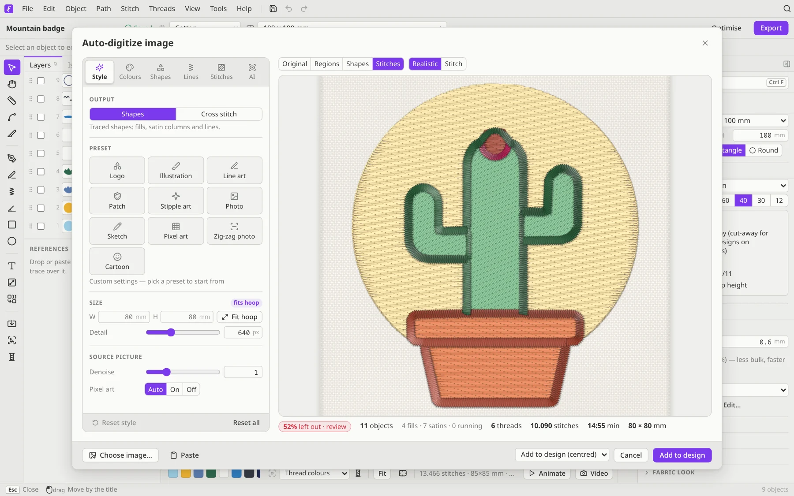
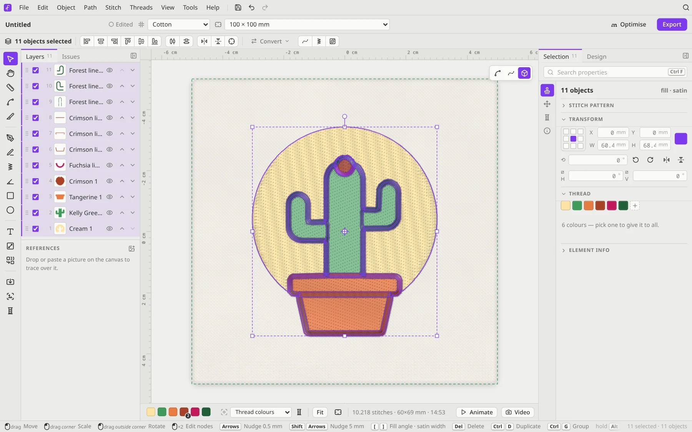
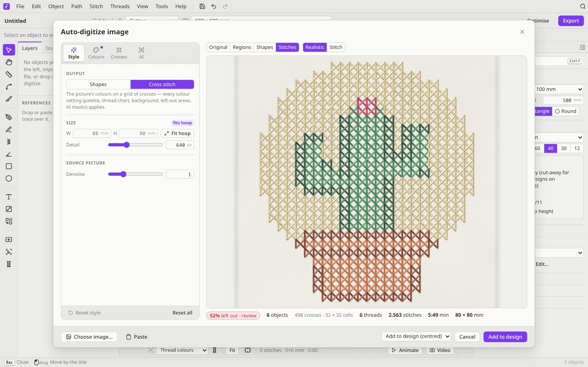

# Auto-digitize

Auto-digitizing turns a picture into stitches. It works best on **logos, clip art and illustrations** with clear shapes and a handful of flat colours. Photos work too, using the *Photo* or *Zig-zag photo* presets.

## Open the digitizer

You can do any of these:

- **File → Digitize a picture…**, or the digitize button at the bottom of the tool rail
- the **Auto-digitize** card on an empty design
- open, drop or paste a picture (PNG, JPG, WEBP, BMP or GIF). Filum asks whether to use it as a reference to trace, or to digitize it.

## Pick a preset

The **Style** tab starts with the output (**Shapes** or **Cross stitch**) and a preset:

| Preset | Best for |
|---|---|
| **Logo** | Crisp shapes, satin for strokes |
| **Illustration** | More colours, finer detail |
| **Line art** | Few colours, satin and running lines |
| **Patch** | Bold fills with a satin border |
| **Stipple art** | A light, sketchy texture |
| **Photo** | Smoothed colours, gradient fills, rows that follow the picture |
| **Sketch** | A line drawing made from the picture |
| **Pixel art** | Sprites and icons: smooth, depixelized shapes |
| **Zig-zag photo** | One colour: the picture as rows of zig-zags, wider and denser where it's darker |
| **Cartoon** | Flat colours with dark outlines on every edge |

Then set the **size** (or click *Fit hoop*) and the amount of **detail**. Under *Source picture*, **Denoise** smooths grainy pictures.

## Fine-tune

The tabs down the left side of the dialog give you more control:

- **Colours**: how many thread colours to use, merging similar colours, snapping to real threads from a **thread chart**, and what to leave out. The background is detected for you. Holes in the design that show the background colour (letter counters, the inside of a ring or an outline) are left as fabric. Small highlights and areas with shapes on them, such as a white badge face, are stitched. Click areas of the picture to stitch them or leave them out. Each colour has a **satin edge** switch: a satin in that colour's own thread where its shapes meet the background, for a clean, raised rim. It ends where another shape lies in front.
- **Sew order** (in the Colours tab): the result's threads, first sewn first. Use the arrows to move a colour earlier (underneath) or later (on top), for example a flower over its stem, or a pot over the plant standing in it. All of a colour's fills, lines and edges are sewn together. **Auto** goes back to the digitizer's own order: the largest colour first and the darkest lines last.
- **Shapes**: how outlines are traced (*Seamless* shapes that share their borders, sharp corners, smooth *Gradients*) and cleaned up (*Smoothing*, *Min. region*, *Simplify*, and *Overlap* so neighbouring colours don't gap).
- **Lines**: dark lines found in the picture, which strokes become **satin** or running-stitch **hairlines**, an optional **border**, and extra lines on top. Those can be *Colour edges*, *Coherent* (a drawing that follows the picture's flow), or the on-device *AI edges* and *AI drawing*.
- **Crosses** (cross-stitch output only): the cell size and how the crosses are laid out.
- **Stitches**: the fill type for areas. You can choose Tatami, Flow, Curved, Contour, Spiral, Sunburst, Circular, Meander, Hilbert or Stipple. This tab also sets the direction and density, and whether to add underlay.
- **AI**: optional on-device helpers (see below).

The preview on the right has tabs for **Original**, **Regions**, **Shapes** and **Stitches**, and the stitch preview can be **Realistic** or plain. Underneath it, a summary shows the number of objects, fills, satins and running lines, threads and stitches, the sewing time and the size. If a big part of the picture is left out, a *review* badge takes you straight to the Colours tab, where you can click areas to stitch them or leave them out.

When you're happy, click **Add to design**. Use the menu next to the button to choose **Add to design (centred)** or **Replace current design**.

The result is ordinary Filum objects, one per region, so you can change any stitch type, colour or shape afterwards. It's worth a look at the **Issues** tab, which flags things like borders that cross themselves.

## Cross stitch from a picture

Choose **File → Cross stitch from a picture…**, or switch the output to **Cross stitch**. The picture becomes a grid of crosses, every colour setting still applies, and the summary shows the number of crosses and the grid size.

To turn shapes you've already drawn into cross stitch, select them and choose **Stitch → Cross stitch shapes…**. You can pick the cell size and the kind of cross: *Both diagonals*, *Half cross*, *Upright cross*, *Double cross* or *Smyrna cross*.

## On-device AI

The **AI** tab can use small machine-learning models that are bundled with Filum and **run on your own computer**. Nothing is uploaded.

- **MobileSAM** segments the picture into objects.
- **DexiNed** finds edges for line work.
- **Informative Drawings** makes a clean line drawing from photos and illustrations.
- **Tesseract** finds text in the picture so it can become real lettering.

They load only when you use them. **Preferences → Digitizer** lists them and can reset the digitizer's settings.

## Tips for good results

- Start from the biggest, cleanest version of the picture you have. Flat colours digitize better than gradients.
- Fewer colours usually stitch better. Try 4–6 for a logo.
- Small text rarely digitizes well. Delete it and retype it with the [Lettering](Lettering.md) tool, or let the AI text finder do it.
- Check the result in the **Realistic** view and with the **Density map** (<kbd>Shift</kbd>+<kbd>D</kbd>) before you export.
