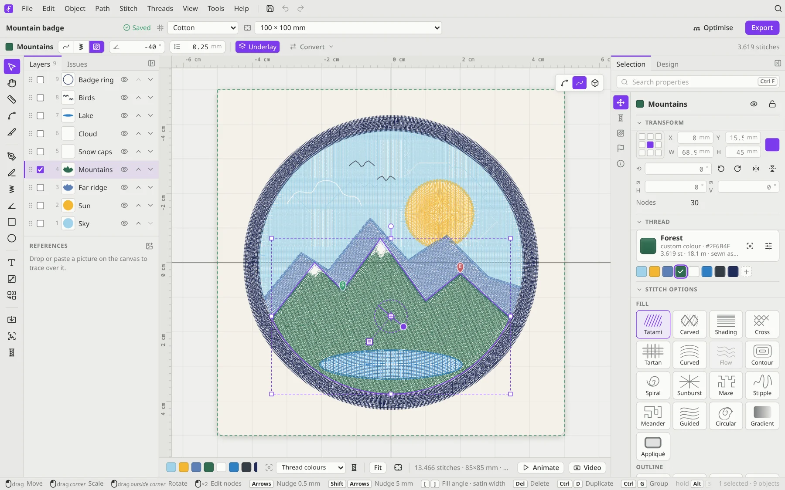

# Drawing and stitch types

Every object in Filum is a shape plus a **stitch type**. Draw a shape with a tool, then choose how it's stitched in the **Selection** panel or the context bar. You can change the stitch type at any time.

## The tools

| Tool | Key | What it does |
|---|---|---|
| Select | <kbd>V</kbd> | Select, move, scale, rotate and skew. <kbd>Alt</kbd>+drag moves a copy, <kbd>Shift</kbd>-click adds to the selection, and double-clicking an object edits its points. |
| Edit nodes | <kbd>A</kbd> | Reshape a path: drag a segment to bend the curve, click a segment to add a point, <kbd>Alt</kbd>-click a point to delete it, double-click to switch between smooth and corner. <kbd>Ctrl</kbd>+<kbd>Alt</kbd>+<kbd>J</kbd> moves the selected points onto their average point. |
| Cutter | <kbd>C</kbd> | Click a line to split it, or drag across a fill to cut it in two. A fill is cut only where your line crosses it, so a short cut across one stroke of a letter leaves the other strokes whole. While you drag, the stretches that will cut are drawn solid. |
| Split into satins | <kbd>K</kbd> | Turn a fill into satins: draw where to cut it and which way to sew each part. See [Split into satins](#split-into-satins). |
| Pan | <kbd>H</kbd> or <kbd>Space</kbd> | Move around the canvas. |
| Ruler | <kbd>M</kbd> | Drag to measure. |
| Pen | <kbd>P</kbd> | Draw a running-stitch path with Bézier curves. Click for a corner, drag for a curve, <kbd>Enter</kbd> to finish. Close the shape to make a fill. |
| Curvature | <kbd>U</kbd> | Click points and the path curves smoothly through them; it bends towards the pointer as you go. Double-click a point to make it a corner (and back), drag a point to move it, click the first point to close. |
| Freehand | <kbd>F</kbd> | Draw by hand. A stabiliser smooths your line into a clean curve, which can become a run, a triple run or a satin. |
| Satin column | <kbd>S</kbd> | Draw a satin column along a path. The scroll wheel or <kbd>[</kbd> <kbd>]</kbd> sets the width of the next point. Choose **Centre line** or **Two sides** in the bar above the canvas. |
| Stitch direction | <kbd>D</kbd> | Draw guide lines across a satin or fill to steer the stitch direction. Click a line and press <kbd>Delete</kbd> (or <kbd>Alt</kbd>-click it) to remove it. |
| Rectangle | <kbd>R</kbd> | Rectangles, polygons and stars, with rounded corners. |
| Ellipse | <kbd>E</kbd> | Ellipses. Hold <kbd>Shift</kbd> for a circle. |
| Lettering | <kbd>T</kbd> | Click and type. See [Lettering](Lettering.md). |
| Gradient | <kbd>G</kbd> | Drag across a fill for a colour gradient, a density gradient or a blend of two colours. See [Threads and colours](Threads-and-Colours.md). |
| Shape builder | <kbd>B</kbd> | Drag across overlapping shapes to merge them. <kbd>Alt</kbd>+drag deletes pieces. |

While a tool is active, the hints line at the bottom shows what each click and key does.

### Split into satins

For letters and shapes you'd rather sew as satin columns than fill: pick the **Split into satins** tool (<kbd>K</kbd>) and click a fill.
- **Drag across the shape** to draw a cut line. The shape is cut where the line runs inside it, so start and end it outside the shape. A cut from the edge into a counter (the hole of an O) opens the counter.
- **<kbd>Alt</kbd>+drag** (or switch the bar to **Direction lines**) to draw the way a part is sewn. The stitches of the part it lies in follow it.
- The canvas shows the parts as you go, tinted, with lines in the direction each will be sewn. A part without a direction line is sewn across its long side; its lines are dashed. A part drawn red isn't one column in that direction: only its longest stretch would be sewn, so cut it again.
- **<kbd>Enter</kbd>** replaces the shape with the satins, grouped, in its place in the sewing order. <kbd>Backspace</kbd> takes back the last line and <kbd>Esc</kbd> clears them.

Neighbouring parts reach 0.1 mm over each cut, so no gap opens when the fabric pulls. With the NOVAstitch fabric preset, they use the preset's overlap instead. Each satin is two rails with as many points on each, so you can reshape it with the node tool like any two-sided satin.

**Path → Convert → Fill to satin** still works the Ink/Stitch way, with rung lines drawn across the shape as objects of their own. The idea and the cutting come from the [NOVAstitch Designer](https://github.com/effepol/NOVAstitch-designer) fork.

### Path commands

Under **Path**:
- **Join** (<kbd>Ctrl</kbd>+<kbd>J</kbd>): one open path closes; several open paths become one, joined each time at their two nearest ends.
- **Compound path → Make** (<kbd>Ctrl</kbd>+<kbd>8</kbd>): the paths of the selected shapes become one object with the style of the one sewn first. In a fill, the inner paths are holes. **Release** (<kbd>Ctrl</kbd>+<kbd>Alt</kbd>+<kbd>Shift</kbd>+<kbd>8</kbd>) makes every path an object of its own again.
- **Nodes → Average points** (<kbd>Ctrl</kbd>+<kbd>Alt</kbd>+<kbd>J</kbd>, node tool): the selected points meet at their average point.
- **Outlines & offsets**, **Effects**, **Combine shapes** (unite, minus front, intersect, exclude, divide) and the **Shape builder** work on the selected shapes as before.

## Line stitches

For outlines, details and lines:

| Type | What it is |
|---|---|
| **Run** | A single running stitch, for outlines and details |
| **Triple** | Triple (bean) stitch: bold, with a hand-stitched look |
| **Heavy** | Five passes for a very bold line |
| **Stem** | Slanted stitches that overlap by half: a rope-like, hand-sewn line |
| **Motif** | A small pattern (wave, scallop, loop, diamond…) repeated along the line |
| **Ripple** | Shapes spiral inwards as shrinking copies, and lines repeat back and forth |

## Satin family

For borders, columns and lettering:

| Type | What it is |
|---|---|
| **Satin** | The smooth, shiny classic for borders and lettering |
| **Zig-zag** | An open zig-zag, for light borders and tack-downs |
| **S-stitch** | Short slanted stitches in an S rhythm, for a corded edge |
| **Blanket** | E-stitch / blanket stitch, for appliqué edges |

Satins have underlay (centre walk, contour, zig-zag), pull compensation and a width you set per point. **Path → Convert** turns fills into satins, satins into centre lines and back again.

**3D satins.** The **3D** section of a satin's stitch options raises it off the fabric, in one of two ways from the Punch digitizing book:

- **Over 3D foam** (puff): the machine stops so you can lay a foam sheet, then sews a straight-stitch contour that perforates the foam (and a centre walk on columns from 4 mm), a satin 1.45 times denser, and short caps across the open ends (of a T, L or E) so the foam doesn't stick out. Tear the rest of the foam away afterwards. Sew foam last: the Issues panel warns when something is sewn after it.
- **Layered**: 2 to 4 inner layers under the column, each 0.6 mm narrower than the next, so no stitch falls within 0.3 mm of one in the layer below. Only the narrowest layer has underlay. **Inner thread** sews the inner layers in another thread, for example polyester under a metallic: a colour change comes before the top layer. Under 6 mm wide the layers have no room to rise, and the Issues panel says so.

The foam density, cap depth and layer step come from the NOVAstitch Designer fork. They are a starting point: check them on a test stitch-out.

**Two ways to edit a satin.** As a **centre line**, a satin is one line with a width: drag the line's points and use the width handles, and the column keeps an even width. As **two sides**, each side is shaped on its own. Choose the way for new satins in the satin tool's bar, and switch any satin back and forth under *Sides* in its stitch options. With the node tool (<kbd>A</kbd>), each side of a two-sided satin takes points of its own: click a side to add a point there, <kbd>Alt</kbd>-click a point to delete it, and drag points and handles freely. <kbd>Ctrl</kbd>-click adds a point to both sides at once. Switching back to a centre line keeps the points where the two sides have the same number, and uses the column's average width.

**Orientation lines.** The dashed lines across a selected satin set its stitch angle. They are its direction guides or, on two sides with the same number of points, the point pairs. Delete one with <kbd>Alt</kbd>-click in the node tool, or pick it in the stitch direction tool (<kbd>D</kbd>) and press <kbd>Delete</kbd>; the trash button under *Direction* removes them all. As soon as you change the lines or the points of one side, the point pairs become ordinary guides, so the stitches keep their angle and every line can be moved or deleted. A deleted line stays deleted. The lines belong to their satin: they move, turn and scale with it, and when you move a point, bend a side or change the width, each line stays at its place on the column.

**Start and end points.** Drag a selected object's **S** and **E** pins to choose where it begins and ends; double-click a pin to make it automatic again. A satin begins at the end nearer the S pin. With the pin partway along, the needle comes in there and runs along the middle of the column to that end, under the satin. With the E pin partway along, the satin is sewn up to it, runs on to the far end and comes back to finish there. A closed outline or a closed satin begins right at the point nearest the pin. An open line always begins and ends at one of its two ends.

A drawing imported as many short strokes can be tidied with **Path → Convert → Connect lines…**: select the pieces and they become as few continuous lines as possible. Ends that meet are joined, loose ends a little apart are bridged by a short straight line (*Bridge gaps up to*), the line carries straight on where strokes cross, and pieces lying on top of another are left out. Each piece is still sewn once, so a branching network needs one line per pair of loose ends. The preview shows how many lines you get before you apply it.

## Fills

For areas:

| Type | What it is |
|---|---|
| **Tatami** | Rows of stitches: the standard fill |
| **Carved** | The needle points line up into a pattern (diamonds, waves, circles…) that catches the light |
| **Shading** | Dense rows that open up across the shape. Set its direction with the gradient tool |
| **Cross** | A grid of little crosses, for the hand-embroidered, pixel look |
| **Tartan** | A woven plaid in several thread colours |
| **Curved** | Rows that follow the outline of the shape |
| **Flow** | Rows that follow the flow of a picture (made by the auto-digitizer) |
| **Contour** | Rings following the outline inwards |
| **Spiral** | One continuous spiral |
| **Sunburst** | Rays from a centre |
| **Maze** | A Hilbert curve: textured and even |
| **Stipple** | A meandering running stitch with a light, quilted texture |
| **Meander** | A random walk over a lattice or one of 75 tiles: a quilted look with few stitches |
| **Guided** | Rows that follow a guide line you can bend on the canvas |
| **Circular** | One spiral around a centre you can drag |
| **Gradient** | A multi-colour gradient with dithering |
| **Appliqué** | A fabric patch: placement line, tack-down and cover. See [Production tools](Production-Tools.md) |

A tatami is sewn **one way**: every part from its top row down to its bottom row, so the fabric is always pushed the same way and never caught between two halves sewn towards each other. Vertical rows go from left to right. If you drag its start point (the **S** pin) near the bottom, the fill goes upwards and begins there; an end point (**E**) near the top does the same and ends there. **Sewing order** in the fill settings switches to **Centre out**, which starts in the middle and sews out to both sides, or to **Ink/Stitch**. The Ink/Stitch order has the least travel, but it ends where it started, which often splits a shape into two halves that meet in the middle. The underlay is sewn in the same order as the rows.

## Handy tricks

- **Change the fill angle** of the selection with <kbd>[</kbd> and <kbd>]</kbd> (5° per press). On a satin, the same keys change the width.
- **Copy stitch settings** from one object to others with <kbd>Ctrl</kbd>+<kbd>Shift</kbd>+<kbd>C</kbd> / <kbd>Ctrl</kbd>+<kbd>Shift</kbd>+<kbd>V</kbd>.
- **Select everything of the same colour or stitch type** with **Edit → Select same**.
- **Combine shapes** with **Object → Combine shapes**: Unite, Minus front, Intersect, Exclude, or Divide into regions.
- **Shape effects** live under **Path → Effects**: round corners, pucker & bloat, zig-zag, roughen, twist, warp, simplify, smooth.
- **Outlines & offsets** (**Path** menu) draws a border, patch backing or appliqué around any selection.
- **Repeat** in a wreath, kaleidoscope, mirror or grid with **Object → Repeat**. A grid sews many patches in one hoop; see [Production tools](Production-Tools.md#many-patches-in-one-hoop).
- **Auto-route** joins several running lines into one continuous path with fewer jumps (**Path → Route**).
- **Trace a picture**: drop or paste it on the canvas and choose *reference*. It stays behind your design and is never stitched. Double-click it to change its opacity or size, or to lock it.
