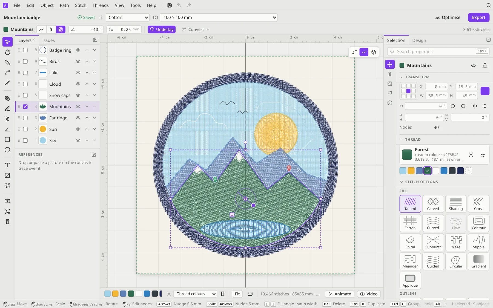

# Drawing and stitch types

Every object in Filum is a shape plus a **stitch type**. Draw a shape with a tool, then choose how it's stitched in the **Selection** panel or the context bar. You can change the stitch type at any time.

## The tools

| Tool | Key | What it does |
|---|---|---|
| Select | <kbd>V</kbd> | Select, move, scale, rotate and skew. <kbd>Alt</kbd>+drag moves a copy, <kbd>Shift</kbd>-click adds to the selection, and double-clicking an object edits its points. |
| Edit nodes | <kbd>A</kbd> | Reshape a path: drag a segment to bend the curve, click a segment to add a point, <kbd>Alt</kbd>-click a point to delete it, double-click to switch between smooth and corner. <kbd>Ctrl</kbd>+<kbd>Alt</kbd>+<kbd>J</kbd> moves the selected points onto their average point. |
| Cutter | <kbd>C</kbd> | Click a line to split it, or drag across a fill to cut it in two. |
| Pan | <kbd>H</kbd> or <kbd>Space</kbd> | Move around the canvas. |
| Ruler | <kbd>M</kbd> | Drag to measure. |
| Pen | <kbd>P</kbd> | Draw a running-stitch path with Bézier curves. Click for a corner, drag for a curve, <kbd>Enter</kbd> to finish. Close the shape to make a fill. |
| Curvature | <kbd>U</kbd> | Click points and the path curves smoothly through them; it bends towards the pointer as you go. Double-click a point to make it a corner (and back), drag a point to move it, click the first point to close. |
| Freehand | <kbd>F</kbd> | Draw by hand. A stabiliser smooths your line into a clean curve, which can become a run, a triple run or a satin. |
| Satin column | <kbd>S</kbd> | Draw a satin column along a path. The scroll wheel or <kbd>[</kbd> <kbd>]</kbd> sets the width of the next point. |
| Stitch direction | <kbd>D</kbd> | Draw guide lines across a satin or fill to steer the stitch direction. |
| Rectangle | <kbd>R</kbd> | Rectangles, polygons and stars, with rounded corners. |
| Ellipse | <kbd>E</kbd> | Ellipses. Hold <kbd>Shift</kbd> for a circle. |
| Lettering | <kbd>T</kbd> | Click and type. See [Lettering](Lettering.md). |
| Gradient | <kbd>G</kbd> | Drag across a fill for a colour gradient, a density gradient or a blend of two colours. See [Threads and colours](Threads-and-Colours.md). |
| Shape builder | <kbd>B</kbd> | Drag across overlapping shapes to merge them. <kbd>Alt</kbd>+drag deletes pieces. |

While a tool is active, the hints line at the bottom shows what each click and key does.

### Path commands

Under **Path**:
- **Join** (<kbd>Ctrl</kbd>+<kbd>J</kbd>): one open path closes; several open paths become one, joined each time at their two nearest ends.
- **Compound path → Make** (<kbd>Ctrl</kbd>+<kbd>8</kbd>): the paths of the selected shapes become one object with the style of the one sewn first. In a fill, the inner paths are holes. **Release** (<kbd>Ctrl</kbd>+<kbd>Alt</kbd>+<kbd>Shift</kbd>+<kbd>8</kbd>) makes every path an object of its own again.
- **Nodes → Average points** (<kbd>Ctrl</kbd>+<kbd>Alt</kbd>+<kbd>J</kbd>, node tool): the selected points meet at their average point.
- **Outlines & offsets**, **Effects**, **Combine shapes** (unite, minus front, intersect, exclude, divide) and the **Shape builder** work on the selected shapes as before.

## Line stitches

For outlines, details and lines:

| Type | What it is |
|---|---|
| **Run** | A single running stitch, for outlines and details |
| **Triple** | Triple (bean) stitch: bold, with a hand-stitched look |
| **Heavy** | Five passes for a very bold line |
| **Stem** | Slanted stitches that overlap by half: a rope-like, hand-sewn line |
| **Motif** | A small pattern (wave, scallop, loop, diamond…) repeated along the line |
| **Ripple** | Shapes spiral inwards as shrinking copies, and lines repeat back and forth |

## Satin family

For borders, columns and lettering:

| Type | What it is |
|---|---|
| **Satin** | The smooth, shiny classic for borders and lettering |
| **Zig-zag** | An open zig-zag, for light borders and tack-downs |
| **S-stitch** | Short slanted stitches in an S rhythm, for a corded edge |
| **Blanket** | E-stitch / blanket stitch, for appliqué edges |

Satins have underlay (centre walk, contour, zig-zag), pull compensation and a width you set per point. **Path → Convert** turns fills into satins, satins into centre lines and back again.

A drawing imported as many short strokes can be tidied with **Path → Convert → Connect lines…**: select the pieces and they become as few continuous lines as possible. Ends that meet are joined, loose ends a little apart are bridged by a short straight line (*Bridge gaps up to*), the line carries straight on where strokes cross, and pieces lying on top of another are left out. Each piece is still sewn once, so a branching network needs one line per pair of loose ends. The preview shows how many lines you get before you apply it.

## Fills

For areas:

| Type | What it is |
|---|---|
| **Tatami** | Rows of stitches: the standard fill |
| **Carved** | The needle points line up into a pattern (diamonds, waves, circles…) that catches the light |
| **Shading** | Dense rows that open up across the shape. Set its direction with the gradient tool |
| **Cross** | A grid of little crosses, for the hand-embroidered, pixel look |
| **Tartan** | A woven plaid in several thread colours |
| **Curved** | Rows that follow the outline of the shape |
| **Flow** | Rows that follow the flow of a picture (made by the auto-digitizer) |
| **Contour** | Rings following the outline inwards |
| **Spiral** | One continuous spiral |
| **Sunburst** | Rays from a centre |
| **Maze** | A Hilbert curve: textured and even |
| **Stipple** | A meandering running stitch with a light, quilted texture |
| **Meander** | A random walk over a lattice or one of 75 tiles: a quilted look with few stitches |
| **Guided** | Rows that follow a guide line you can bend on the canvas |
| **Circular** | One spiral around a centre you can drag |
| **Gradient** | A multi-colour gradient with dithering |
| **Appliqué** | A fabric patch: placement line, tack-down and cover. See [Production tools](Production-Tools.md) |

## Handy tricks

- **Change the fill angle** of the selection with <kbd>[</kbd> and <kbd>]</kbd> (5° per press). On a satin, the same keys change the width.
- **Copy stitch settings** from one object to others with <kbd>Ctrl</kbd>+<kbd>Shift</kbd>+<kbd>C</kbd> / <kbd>Ctrl</kbd>+<kbd>Shift</kbd>+<kbd>V</kbd>.
- **Select everything of the same colour or stitch type** with **Edit → Select same**.
- **Combine shapes** with **Object → Combine shapes**: Unite, Minus front, Intersect, Exclude, or Divide into regions.
- **Shape effects** live under **Path → Effects**: round corners, pucker & bloat, zig-zag, roughen, twist, warp, simplify, smooth.
- **Outlines & offsets** (**Path** menu) draws a border, patch backing or appliqué around any selection.
- **Repeat** in a wreath, kaleidoscope or mirror with **Object → Repeat**.
- **Auto-route** joins several running lines into one continuous path with fewer jumps (**Path → Route**).
- **Trace a picture**: drop or paste it on the canvas and choose *reference*. It stays behind your design and is never stitched. Double-click it to change its opacity or size, or to lock it.
