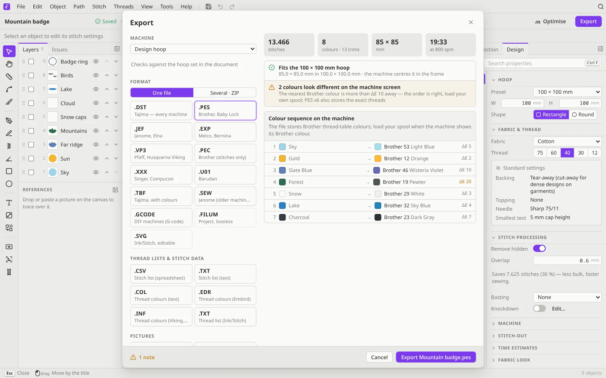
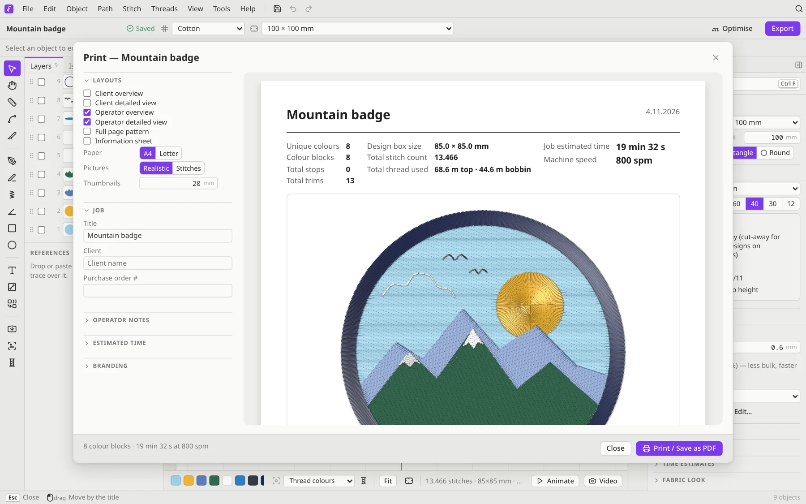

# Export and print

## Export for your machine

Click **Export** in the title bar (<kbd>Ctrl</kbd>+<kbd>E</kbd>).

1. **Machine**: choose your machine, and the dialog checks the design against its hoop and limits.
2. **Format**: Filum suggests the right one for your machine. Choose **One file**, or **Several · ZIP** to get several formats, the thread list and pictures in one ZIP.
3. **Thread lists & stitch data** and **Pictures**: optional extras that go into the ZIP.
4. **PES version** (PES files only): **v1 · Brother colours** is the most compatible, and every Brother machine reads it. **v6 · exact threads** stores the brand, code and name of each thread, but older machines may not read it.
5. **Origin**: whether the design is centred on the needle position (the machine default) or starts from a fixed point.

The top of the dialog shows the stitch count, colours, size and time. A **pre-flight check** then reports either **Ready for the machine** or the problems it found, such as a design too big for the hoop or more colours than the format can describe. **Colour sequence on the machine** lists the threads in the order your machine will ask for them.

### Which format?

| Your machine | Format |
|---|---|
| Brother, Baby Lock | **PES** (or PEC) |
| Janome, Elna | **JEF** (older Janomes: SEW) |
| Tajima and most commercial machines | **DST** (Tajima with colours: TBF) |
| Melco, Bernina | **EXP** |
| Pfaff, Husqvarna Viking | **VP3** |
| Singer, Compucon | **XXX** |
| Barudan | **U01** |
| DIY / CNC machines | **G-code** |

**All the formats:**
- **Read and write**: DST, PES, PEC, JEF, EXP, VP3, XXX, U01, TBF, SEW, Ink/Stitch SVG and Filum projects (`.filum`).
- **Read only**: HUS, SHV, PCS, PCD, PCQ, PCM, KSM, MAX, SPX, PHB, PHC, JPX, DSB, DSZ, ZXY, TAP, DAT, STX, EMD, EXY, FXY, ZHS, 10O, 100, BRO, GT, INB, MIT, NEW and STC.
- **Write only**: G-code, thread colour lists (COL, EDR, INF and a TXT thread list), stitch lists as a spreadsheet (CSV) or text (TXT), PNG pictures and ZIP bundles.

> Machine files store only stitches and colours. Always keep the `.filum` project too, because it keeps every object, setting and colour edit.

### Repeats and stops

The extras in the Export dialog can also lay out **repeats**: copies side by side or below each other, for sewing several patches in one hooping. They can also decide where the frame waits when the design has stops, such as the stops in an appliqué.

## Work with Inkscape

**File → Export Ink/Stitch SVG** writes an SVG with Ink/Stitch's own attributes, so you can keep working on the design in Inkscape with the Ink/Stitch extension. Ink/Stitch SVGs open in Filum too, with their stitch settings.

## Print a job sheet

**File → Print / PDF…** (<kbd>Ctrl</kbd>+<kbd>P</kbd>) makes sheets for the people who'll see the design:

- **Client overview** and **Client detailed view**: a nice picture of the design to send for approval
- **Operator overview** and **Operator detailed view**: what the machine operator needs, like the colour sequence, the stops, the size and the time

Add the job details, operator notes, the estimated time and your own branding. To get a PDF, choose **Save as PDF** in your system's print dialog.

## Pictures and video

- **Pictures**: the Export dialog can add a **Realistic picture** or a **Simple picture (lines)** as PNG, with a transparent, white or fabric-coloured background.
- **Stitch-out video**: **Video** in the bottom bar (or the camera in the stitch-out player) records the stitch-out animation at the player's speed as a `.webm` file. That's great for showing a client or posting online. In the browser, this needs a browser that supports recording (MediaRecorder).
