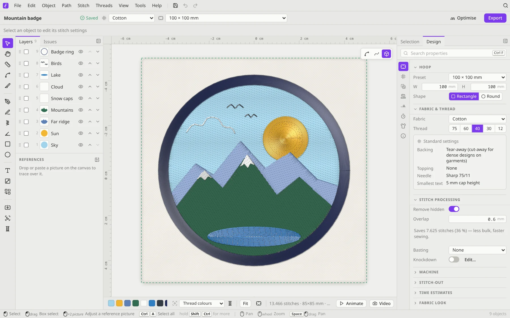

# Welcome to Filum 🧵

Filum is a free machine-embroidery editor. You draw or import artwork, choose how each part should be stitched, see a realistic preview, and export a file your embroidery machine understands.

## New here?

1. **[Getting started](Getting-Started.md)**: run Filum and stitch your first design in ten minutes.
2. **[A tour of the editor](Tour-of-the-Editor.md)**: what every panel and button is for.
3. **[Auto-digitize](Auto-Digitize.md)**: the quickest way from a logo to stitches.

## Guides

| Page | What you'll learn |
|---|---|
| [Drawing and stitch types](Drawing-and-Stitch-Types.md) | Pen, satin, freehand and shape tools, and every stitch type |
| [Auto-digitize](Auto-Digitize.md) | Presets, colours and cleaning up the result; cross stitch from a picture |
| [Lettering](Lettering.md) | Embroidery fonts, your own TTF/OTF fonts, arcs, text on a path, batch names |
| [Threads and colours](Threads-and-Colours.md) | Thread charts, *My threads*, matching colours, gradients |
| [Production tools](Production-Tools.md) | Fabric presets, appliqué, knockdown, basting, hidden stitches, optimising, test swatches |
| [Export and print](Export-and-Print.md) | Machine formats, the pre-flight check, job sheets, stitch-out videos |
| [Keyboard shortcuts](Keyboard-Shortcuts.md) | All the shortcuts on one page |
| [Command line](Command-Line.md) | `filum convert`, `info`, `optimize`, `digitize` |
| [Building from source](Building-from-Source.md) | For developers: toolchain, builds, project layout |
| [FAQ and troubleshooting](FAQ.md) | Common questions and fixes |

## A word on embroidery terms

If you're new to machine embroidery, these words come up a lot:

- **Hoop**: the frame that holds the fabric. Your design has to fit inside it.
- **Running stitch**: a simple line of stitches, used for outlines and details.
- **Satin**: a column of tight zig-zag stitches. It looks smooth and shiny, which suits borders and lettering.
- **Fill** (or *tatami*): rows of stitches that cover an area.
- **Underlay**: stitches sewn first, under the visible ones. They hold the fabric still and give the top stitches something to sit on.
- **Pull compensation**: thread pulls fabric inwards, so shapes are stitched slightly wider to come out the right size.
- **Jump / trim**: the machine moves to a new spot without stitching, and may cut the thread on the way.

Filum builds on [Ink/Stitch](https://inkstitch.org), and much of its documentation applies here too.
