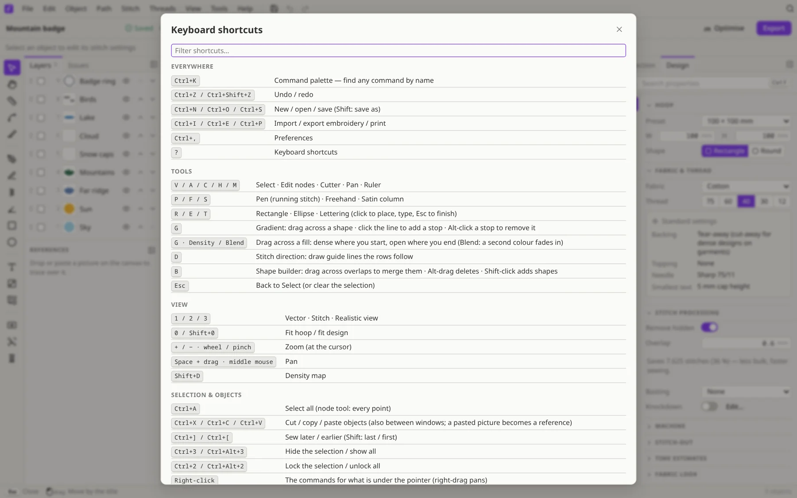

# Keyboard shortcuts

Press <kbd>?</kbd> in Filum to see this list in the app, with a filter box. On a Mac, <kbd>Ctrl</kbd> is <kbd>⌘</kbd>. Can't find a command? Press <kbd>Ctrl</kbd>+<kbd>K</kbd> and type its name.

## Everywhere

| Keys | What it does |
|---|---|
| Ctrl+K | Command palette — find any command by name |
| Ctrl+Z / Ctrl+Shift+Z | Undo / redo |
| Ctrl+N / Ctrl+O / Ctrl+S | New / open / save (Shift: save as) |
| Ctrl+I / Ctrl+E / Ctrl+P | Import / export embroidery / print |
| Ctrl+, | Preferences |
| ? | Keyboard shortcuts |

## Tools

| Keys | What it does |
|---|---|
| V / A / C / H / M | Select · Edit nodes · Cutter · Pan · Ruler |
| P / F / S | Pen (running stitch) · Freehand · Satin column |
| R / E / T | Rectangle · Ellipse · Lettering (click to place, type, Esc to finish) |
| G | Gradient: drag across a shape · click the line to add a stop · Alt-click a stop to remove it |
| G · Density / Blend | Drag across a fill: dense where you start, open where you end (Blend: a second colour fades in) |
| D | Stitch direction: draw guide lines the rows follow |
| B | Shape builder: drag across overlaps to merge them · Alt-drag deletes · Shift-click adds shapes |
| Esc | Back to Select (or clear the selection) |

## View

| Keys | What it does |
|---|---|
| 1 / 2 / 3 | Vector · Stitch · Realistic view |
| 0 / Shift+0 | Fit hoop / fit design |
| + / − · wheel / pinch | Zoom (at the cursor) |
| Space + drag · middle mouse | Pan |
| Shift+D | Density map |

## Stitch-out player

| Keys | What it does |
|---|---|
| Animate (bottom bar) | Open the player and play the stitch-out |
| ← / → | One stitch back / forward |
| Shift+← / Shift+→ | Previous / next colour block |
| Home / End | To the start / the end |
| Click or drag the timeline | Go to that stitch |
| Esc | Close the player |

## Selection & objects

| Keys | What it does |
|---|---|
| Ctrl+A | Select all (node tool: every point) |
| Ctrl+X / Ctrl+C / Ctrl+V | Cut / copy / paste objects (also between windows; a pasted picture becomes a reference) |
| Ctrl+] / Ctrl+[ | Sew later / earlier (Shift: last / first) |
| Ctrl+3 / Ctrl+Alt+3 | Hide the selection / show all |
| Ctrl+2 / Ctrl+Alt+2 | Lock the selection / unlock all |
| Right-click | The commands for what is under the pointer (right-drag pans) |
| Ctrl+D / Alt+D / Del | Duplicate / linked clone / delete |
| Arrows (Shift) | Nudge 0.5 mm (5 mm) |
| Ctrl+G / Ctrl+Shift+G | Group / ungroup |
| Ctrl+Shift+C / Ctrl+Shift+V | Copy / paste stitch properties |
| [ / ] with a selection | Rotate the fill angle 5° · change the satin width (Shift: more) |
| Double-click an object | Edit its nodes (lettering: edit its text) |
| Ctrl-click | Pick one object inside a group |

## Transform

| Keys | What it does |
|---|---|
| Alt + drag an object | Move a copy |
| Shift while dragging | Constrain · rotation in 15° steps |
| Scale handles | Free · Shift: keep proportions · Alt: from the centre · drag past an edge to flip |
| Rotate | Drag just outside a corner (or the top knob) · Alt-drag the pivot to move it |
| Ctrl + drag a side handle | Skew (Shift: 15° steps) |
| Ctrl while dragging | Ignore smart guides |

## Pen & satin

| Keys | What it does |
|---|---|
| Click · drag | Corner point · smooth point with handles (Alt: break the handles, Space: move the point, Shift: snap angles) |
| While drawing | Drag points and handles · click a segment to add a point · Alt-click a point to delete · double-click: smooth ↔ corner |
| Click an end of a selected path | Continue drawing that path |
| Satin: scroll or [ ] | Width of the next point · scroll over a point to change its width |
| Enter / Esc / Backspace | Finish the path (the tool stays) / finish / remove the last point |
| Freehand | The line trails the pointer and becomes a clean Bézier path · end at the start to close |
| Pen | Points snap to existing points (Ctrl: off) · ending on the end of another running path joins them |
| Cutter | Click a line to split it, drag across fills to cut them |

## Node tool

| Keys | What it does |
|---|---|
| Click a segment / Alt-click a point | Add a point (a rung pair on two-rail satins) / delete it |
| Click · Shift-click · drag a box | Select points · drag to move them (Shift: straight, Ctrl: no snapping) |
| Del / Shift+Del | Delete the points keeping the curve's shape / plain delete |
| Arrows (Shift) | Nudge the points 0.1 mm (1 mm) |
| Shift+C / S / Y | Corner / smooth / symmetric points |
| Shift+L / U | Straight / curved segments |
| Shift+B / J | Break the path at the points / join two end points |
| Alt-drag a handle | Break the symmetry |

## Pictures & lettering

| Keys | What it does |
|---|---|
| Drop or paste a picture | Choose: a reference to trace (never stitched) or digitize it |
| Double-click a reference | Adjust it · Enter: done · Del: remove |
| Lettering handles | Drag the arch handle to bend, the arrows to space letters · double-click to reset |

## Tools at a glance

| Key | Tool |
|---|---|
| <kbd>V</kbd> | Select |
| <kbd>A</kbd> | Edit nodes |
| <kbd>C</kbd> | Cutter |
| <kbd>H</kbd> | Pan |
| <kbd>M</kbd> | Ruler |
| <kbd>P</kbd> | Pen (running stitch) |
| <kbd>F</kbd> | Freehand |
| <kbd>S</kbd> | Satin column |
| <kbd>D</kbd> | Stitch direction |
| <kbd>R</kbd> | Rectangle |
| <kbd>E</kbd> | Ellipse |
| <kbd>T</kbd> | Lettering |
| <kbd>G</kbd> | Gradient |
| <kbd>B</kbd> | Shape builder |
## Also handy

| Keys | What it does |
|---|---|
| Ctrl+Shift+P | Command palette (same as Ctrl+K) |
| Ctrl+Y | Redo |
| Ctrl+F | Search properties in the right-hand panel |
| Ctrl+\\ | Hide / show the panels |
| Ctrl+Shift+S | Save as |
