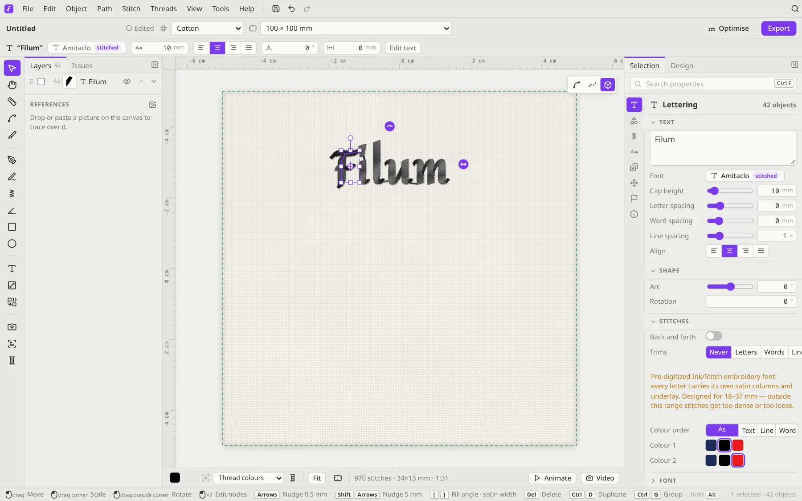
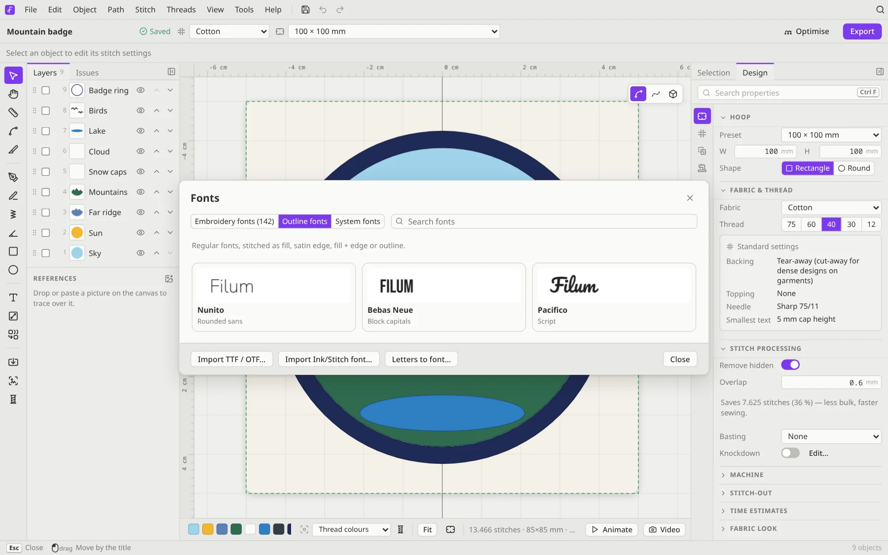
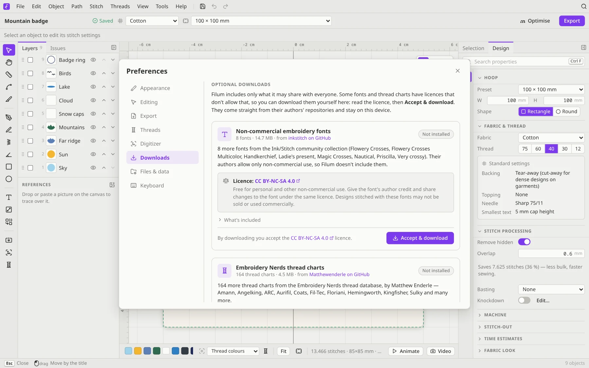

# Lettering

Press <kbd>T</kbd> (or pick the **Lettering** card on an empty design), click where the text should go, and type. Press <kbd>Esc</kbd> when you're done. The text stays editable: double-click it any time to change the words.

## Fonts

Click the font name in the context bar (**Choose font**) to open the **Fonts** dialog. It has three tabs:

- **Embroidery fonts**: **134** pre-digitized fonts from the Ink/Stitch community collection are bundled, and 8 more are an optional download (see below). Every letter was digitized by hand with its own satin columns and underlay, so these give the best results. Each font is designed for a range of sizes (for example 18–37 mm), and Filum warns you if you go outside it. The collection includes right-to-left and multi-colour fonts, and everything works offline.
- **Outline fonts**: TTF/OTF fonts, stitched by Filum as a fill, a satin edge, a fill with an edge, or a triple-run outline. Nunito, Bebas Neue and Pacifico come bundled.
- **System fonts**: the fonts installed on your computer, in browsers that can list them.

**Import TTF / OTF…** adds your own font file. **Import Ink/Stitch font…** adds a font folder in Ink/Stitch's format (a `font.json` plus its SVG files). **Letters to font…** builds a font from a folder of embroidery files with one letter each, named like `Font_A.pes`, `Font_B.pes` and so on.

> **Licences:** most embroidery fonts use the SIL Open Font License, and some use Creative Commons licences. **Help → Licences** lists every font with its licence.

### Non-commercial fonts: an optional download

Eight fonts (Flowery Crosses, Flowery Crosses Multicolor, Handkerchief, Ladie's present, Magic Crosses, Nautical, Priscilla and Very crossy) are licensed for **non-commercial use only** (CC BY-NC-SA 4.0), so Filum doesn't include them. They appear in the font picker as **Optional download**. Click one, or open **Preferences → Downloads** (also **Help → Optional downloads…**), read the licence and click **Accept & download**. Filum fetches them from the Ink/Stitch font repository (about 15 MB) and keeps them on your device. They then work like every other font. Designs that use one keep their stitches either way; to change their text, download the font.

## Shaping the text

The context bar and the **Selection** panel have:

- **Cap height**: the size of the capital letters, in millimetres
- **Letter spacing**, **word spacing** and **line spacing**, plus the alignment
- **Arc**: bend the text into an arch. A positive value arches up, a negative one arches down.
- **Rotation**

On the canvas, drag the **arch handle** to bend the text and the **arrows** to space the letters. Double-click a handle to reset it.

## Text on a path

Select a lettering object and a line, and the context bar offers **Text on path**. The **On a path** section then controls where the text sits along the line.

## Stitches and colours

The **Stitches** section sets whether the machine sews **back and forth** along a line, and when it **trims**: *Never*, between *Letters*, between *Words* or between *Lines*. For multi-colour fonts, **Colour order** can sew each colour in one go within the whole **Text**, each **Line** or each **Word**, which means fewer colour changes. **As drawn** keeps the font's own order.

## Batch lettering

**Batch lettering** turns one design into many files with different text, like a set of name tags. Type the names (split by a separator you choose), pick the file formats, and Filum exports one file per name in a ZIP.

## Tips

- For text smaller than about 5 mm cap height, use a pre-digitized embroidery font made for small sizes, and a fine thread (No. 60 or 75). **Design → Fabric & thread** shows the smallest recommended text for your fabric and thread.
- Satin letters on towels and fleece sink into the pile. Add **Knockdown** stitches underneath (see [Production tools](Production-Tools.md)).
