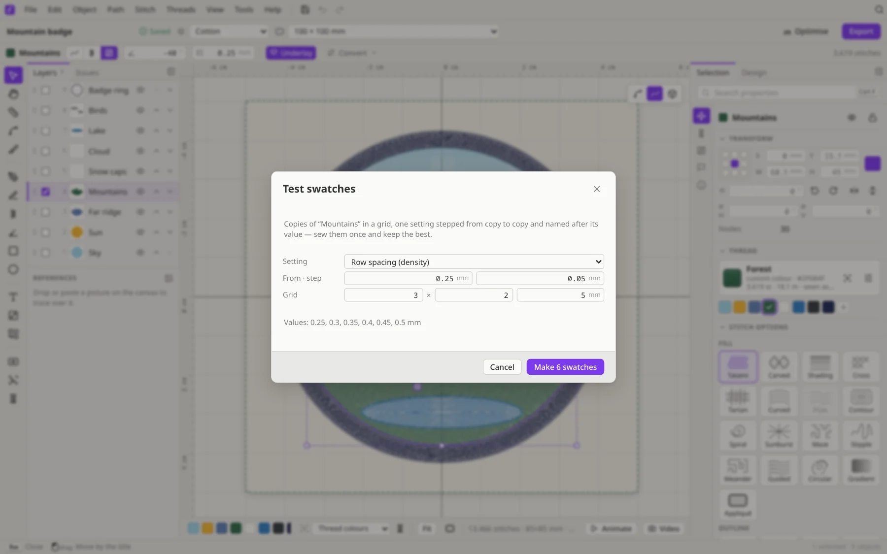
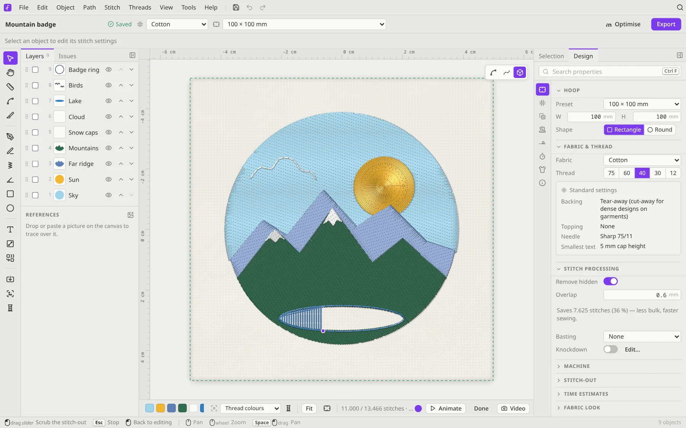

# Production tools

These are the tools that take a design from "looks nice" to "sews nicely": fabric settings, appliqué, knockdown, basting, trimming the stitch count, and testing.

## Fabric and thread

Choose your fabric in the title bar or under **Design → Fabric & thread**. The choices are Cotton, Polyester, Denim, Knit / Jersey, Piqué / Polo, Fleece, Towel / Terry, Organza / Sheer, Silk / Satin, Canvas, Leather / Vinyl, Felt and Cap / Structured. The preset adjusts the density, underlay and pull compensation of the whole design.

Pick the **thread** weight too (No. 75 down to No. 12). Filum then recommends a **backing**, a **topping**, a **needle**, and the **smallest text** that will stitch cleanly. The recommendations come from stabiliser, needle and thread makers' guides, and the panel notes where the makers disagree.

## Machine and stitch-out

The **Design** tab's *Machine* section has presets for Baby Lock, Bernina, Brother, Janome, Pfaff / Viking, Singer and commercial machines. **Stitch-out** sets:
- tie-in / tie-off and the start and end locks
- *Trim jumps over* (the length at which jumps are trimmed)
- the minimum and maximum stitch length

**Time estimates** work out the sewing time from your machine's speed.

## Stitch processing

Under **Design → Stitch processing**:

- **Remove hidden** leaves out stitching that's covered by objects sewn on top. It's non-destructive, so your shapes don't change, and you set an **overlap** margin. A readout shows how many stitches it saves. You'll also find it at **Stitch → Remove hidden stitching**.
- **Basting** sews a temporary tacking line that holds the fabric to the backing: **Box around the design** or **Following the design**, with its own distance and stitch length.
- **Knockdown** puts a light layer of stitches under the design, so it doesn't sink into towels, fleece or velvet. Click **Edit…** (or **Stitch → Knockdown…**) to set it up for the whole design or just the selection.

## Appliqué

Select a shape and choose **Stitch → Make appliqué** (or the **Appliqué** stitch type). The machine then sews it in three steps, with stops in between:

1. **Placement line**: shows where to lay the fabric patch.
2. **Tack-down**: holds the patch in place after you've laid it.
3. **Cover**: a satin or blanket stitch over the raw edge.

The *Machine stops* row controls where the machine pauses so you can place and trim the fabric. **Path → Outlines & offsets…** is handy for making appliqué and patch borders around any selection.

## Optimise

Click **Optimise** in the title bar (or **Stitch → Optimise stitch order**). Filum reorders the objects to cut colour changes and travel, without changing which object ends up on top. A message tells you how the colour changes and the travel distance changed (for example "Optimised: colour changes 6 → 5, travel 131 → 202 mm").

Related commands:
- **Stitch → Clean up tiny objects** removes leftovers too small to stitch.
- **Path → Route** auto-routes running stitches and satin columns into continuous paths, and can turn jumps into running stitch.
- **Object → Stitch order** moves the selection earlier or later (<kbd>Ctrl</kbd>+<kbd>[</kbd> / <kbd>Ctrl</kbd>+<kbd>]</kbd>).

## Test swatches

Not sure which density or pull compensation suits your fabric? Select an object and choose **Stitch → Test swatches…**. Pick a setting, such as row spacing (density), stitch length, pull compensation or angle. Then set a start value, a step and a grid. Filum makes copies of the object in a grid, one value per copy, each named after its value. Sew it once and keep the best.

## Cutwork

For machines with cutwork needles, **Path → Cutwork segmentation** splits running stitches by angle, one range per needle. Running stitches also get a **Cutwork** section where you set each needle's angle range.

## Before you export

- **Issues** (left panel, or **Stitch → Troubleshoot…**) lists anything that could go wrong on the machine.
- The **Density map** (<kbd>Shift</kbd>+<kbd>D</kbd>) shows where stitches pile up.
- **Animate** in the bottom bar plays the stitch-out, so you can check the sew order and the jumps.

