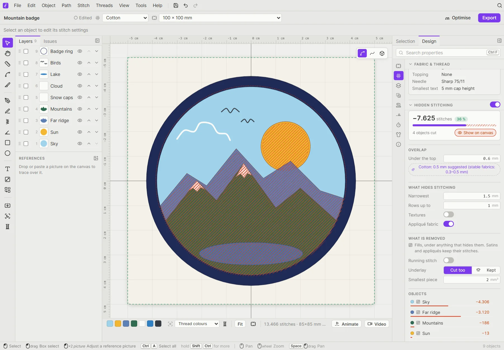
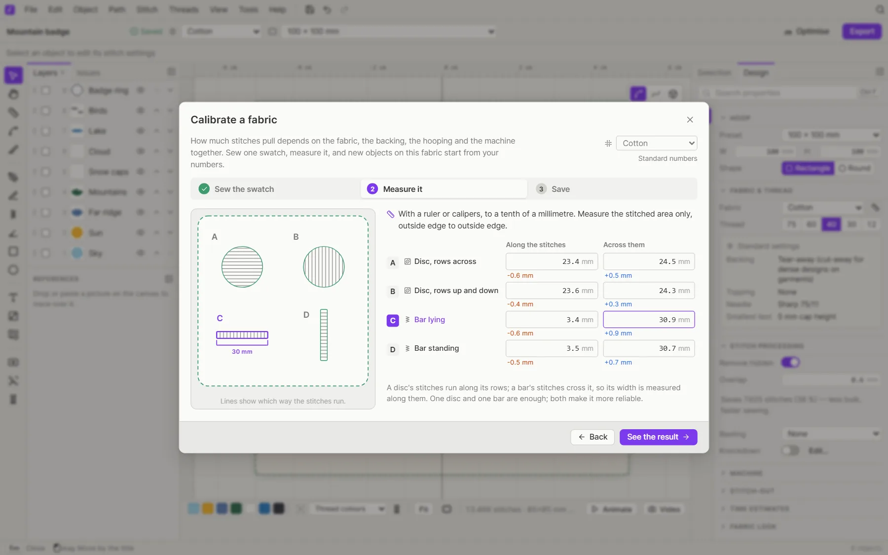

# Production tools

These are the tools that take a design from "looks nice" to "sews nicely": fabric settings, appliqué, knockdown, basting, trimming the stitch count, and testing.

## Fabric and thread

Choose your fabric in the title bar or under **Design → Fabric & thread**. The choices are Cotton, Polyester, Denim, Knit / Jersey, Piqué / Polo, Fleece, Towel / Terry, Organza / Sheer, Silk / Satin, Canvas, Leather / Vinyl, Felt and Cap / Structured. The preset adjusts the density and underlay of the whole design. Pull compensation is off by default, as in Ink/Stitch: calibrate the fabric (below) and new objects start from the pull compensation it measures.

Pick the **thread** weight too (No. 75 down to No. 12). Filum then recommends a **backing**, a **topping**, a **needle**, and the **smallest text** that will stitch cleanly. The recommendations come from stabiliser, needle and thread makers' guides, and the panel notes where the makers disagree.

## Machine and stitch-out

The **Design** tab's *Machine* section has presets for Baby Lock, Bernina, Brother, Janome, Pfaff / Viking, Singer and commercial machines. **Stitch-out** sets:
- tie-in / tie-off and the start and end locks
- *Trim jumps over* (the length at which jumps are trimmed, see [Where Filum trims](#where-filum-trims))
- the minimum and maximum stitch length

**Time estimates** work out the sewing time from your machine's speed.

### Where Filum trims

Filum follows the usual machine-embroidery conventions:
- **Gaps longer than *Trim jumps over*** (3 mm to start) are tied off, trimmed, jumped and tied in again, in that order. You can change the length for the whole design, or for a single object under its stitch options.
- **A shorter gap to the next object** is sewn straight across, as Ink/Stitch does, because a cut that short isn't worth a trim. The exception is a connecting stitch longer than 2 mm that nothing sewn later covers: that one would lie across the fabric, so it's trimmed as well (commercial digitizing software trims from 2 mm).
- **A colour change** is tied off but not trimmed first: the machine cuts the thread itself when it changes colour.
- **Stops** (appliqué steps) and the end of the design are tied off and trimmed.
- **Inside a fill**, travel runs under stitching still to come or along sewn rows. Where a part is walled in by rows already sewn, a straight travel may cross them for at most 2 mm; anything longer is trimmed rather than left on top of the finished rows.

### What your machine cuts

A trim command asks the machine to cut; whether it does depends on its thread cutter. Set it under **Design → Machine → Stitch-out → Thread cutter**:
- **Cuts every trim**: most multi-needle and commercial machines.
- **Cuts longer jumps only**: Brother and Baby Lock home machines cut a jump only when it is longer than their *jump stitch trimming* length (5 mm by default, 5 to 50 mm). Their machine presets set this for you.
- **None: snip by hand**: machines without a cutter.

The jumps your machine won't cut stay on the fabric, so Filum draws them as thread in every view, in the stitch-out and in exported pictures. The export dialog counts them, and the job sheet lists them under *Snip by hand*. When you export a PES with the cutter left at *Cuts every trim*, the export dialog still tells you how many jumps a Brother machine would leave uncut at its default 5 mm.

Turn on **View → Show → Jump stitches** to check the trims: jumps show as dashed lines, a small triangle marks every cut, and a ring marks where the jump lands. Marks in amber are trims your machine leaves uncut.

## Stitch processing

Under **Design → Stitch processing**:

- **Basting**, **Knockdown**: see below.

## Hidden stitching

Where an object is sewn on top of another, the stitching underneath is never seen, but it still adds bulk, needle holes and sewing time. **Design → Hidden stitching** (the switch in its title, or **Stitch → Remove hidden stitching**) leaves it out. Nothing is destructive: your shapes stay as drawn, and the stitches come back as soon as you change your mind.

- **The readout** shows how many stitches it saves and how many objects it cuts. **Show on canvas** hatches what is left out, right on the design.
- **Overlap → Under the top**: how far a cut fill still reaches under the object on top, so no gap opens when the fabric pulls. Digitizers use about 0.3–0.5 mm on stable fabrics and 0.8–1.0 mm on knits; Filum suggests a value for the design's fabric.
- **What hides stitching**:
  - **Narrowest**: an object only hides what's under it where it is at least this wide. Outlines, thin borders and narrow satins leave the fill under them whole (1.5 mm by default).
  - **Rows up to**: fills and satins with rows further apart than this are open and show what's under them (1 mm by default).
  - **Textures**: stipple, meander, Hilbert and cross-stitch fills leave fabric showing, so by default they don't hide anything.
  - **Appliqué fabric**: the fabric of an appliqué hides what's under it. Its placement, tack-down and cover stitches are never cut.
  - The colours of one gradient or tartan never hide each other, and a colour blend (or any fill whose rows open up towards one end) never hides what's under it.
- **What is removed**: fills, always. **Running stitch** cuts lines under a cover too, reaching the overlap under it. **Underlay → Kept** sews the cut fill's whole underlay, so the fabric under the object on top stays steady. **Smallest piece** leaves out leftover pieces too small to be worth a jump and a trim, and doesn't cut holes that small.
- **Objects** lists every object that loses stitches, most first. Click one to select it, or the tick to let it keep its stitches. Objects set by hand are listed under it.

Each object has its own **Selection → Hidden stitching** section: **Hides** (Auto, Always or Never) decides whether stitching under it is left out, with a line explaining what Auto does for this object, and **Keep its stitches** sews it whole even where something hides it. The section also says how many of its stitches are left out. These settings are kept in Filum files and in SVG.

- **Basting** sews a temporary tacking line that holds the fabric to the backing: **Box around the design** or **Following the design**, with its own distance and stitch length.
- **Knockdown** puts a light layer of stitches under the design, so it doesn't sink into towels, fleece or velvet. Click **Edit…** (or **Stitch → Knockdown…**) to set it up for the whole design or just the selection.

## Appliqué

Select a shape and choose **Stitch → Make appliqué** (or the **Appliqué** stitch type). The machine then sews it in three steps, with stops in between:

1. **Placement line**: shows where to lay the fabric patch.
2. **Tack-down**: holds the patch in place after you've laid it.
3. **Cover**: a satin or blanket stitch over the raw edge.

The *Machine stops* row controls where the machine pauses so you can place and trim the fabric. **Path → Outlines & offsets…** is handy for making appliqué and patch borders around any selection.

## Optimise

Click **Optimise** in the title bar (or **Stitch → Optimise stitch order**). Filum reorders the objects to cut colour changes and travel, without changing which object ends up on top. A message tells you how the colour changes and the travel distance changed (for example "Optimised: colour changes 6 → 5, travel 131 → 202 mm").

Related commands:
- **Stitch → Clean up tiny objects** removes leftovers too small to stitch.
- **Path → Route** auto-routes running stitches and satin columns into continuous paths, and can turn jumps into running stitch.
- **Object → Stitch order** moves the selection earlier or later (<kbd>Ctrl</kbd>+<kbd>[</kbd> / <kbd>Ctrl</kbd>+<kbd>]</kbd>).

### Calibrate a fabric

The presets are starting points. How much the thread pulls also depends on your backing, how tightly you hoop and your machine. To match your own setup, click the ruler button next to the fabric (or choose **Stitch → Calibrate fabric…**):

1. **Sew the swatch.** Download a 100 × 100 mm file in your machine's format and sew it the way you always do. It has two fill discs (rows across, rows up and down) and two satin bars (lying, standing), each labelled A to D in running stitch, and no pull compensation of its own. The panel shows the backing, topping and needle the fabric preset suggests.
2. **Measure it.** Measure each piece along its stitches and across them, to a tenth of a millimetre. The diagram points at the size you're typing, and each field shows how far it is from the drawn size. One disc and one bar are enough; all four make the numbers more reliable.
3. **Save.** Filum works out the satin pull compensation and how far the column ends are pulled in, and for fills the pull compensation and how much smaller (or larger) the shape is stitched. It explains each number and notes anything odd, like a fabric that gives more in one direction or a measurement far from the drawing.

The calibration is saved for that fabric on this device. New satins and fills on it start from your numbers, and you can still change them per object. Objects already in a design keep theirs, unless you tick **Also update the objects in this design** (one undo step). A calibrated fabric shows a filled ruler button; **Standard numbers** in the dialog forgets the calibration.

## Test swatches

Not sure which density or pull compensation suits your fabric? Select an object and choose **Stitch → Test swatches…**. Pick a setting, such as row spacing (density), stitch length, pull compensation or angle. Then set a start value, a step and a grid. Filum makes copies of the object in a grid, one value per copy, each named after its value. Sew it once and keep the best.

## Cutwork

For machines with cutwork needles, **Path → Cutwork segmentation** splits running stitches by angle, one range per needle. Running stitches also get a **Cutwork** section where you set each needle's angle range.

## Before you export

- **Issues** (left panel, or **Stitch → Troubleshoot…**) lists anything that could go wrong on the machine. Among them: lines lying on top of each other (a stroke imported twice, a piece drawn over another, a line running back over itself), which sew the thread twice and look heavier. The fix deletes a line that lies wholly on another, or cuts out just the doubled stretch.
- The **Density map** (<kbd>Shift</kbd>+<kbd>D</kbd>) shows where stitches pile up.
- **Animate** in the bottom bar opens the stitch-out player and plays the design stitch by stitch, so you can check the sew order and the jumps.

### The stitch-out player

The player sits between the canvas and the bottom bar while it's open.

- **Timeline**: one lane per colour block, in sew order, with each block's stitches and machine time next to its thread. Each bar shows where its block falls in the stitch-out: faded where it is still to sew, in the thread colour where it is sewn. Thin ticks mark trims inside a block, and the round marker at the end of a bar is the thread change (or a stop). Click or drag anywhere on the timeline to go to that stitch, or click a thread's name to go to the start of its block. Point at the timeline to see the stitch, the time and the colour there.
- **Colour sequence**: the strip under the ruler shows every block in order, sewn part in full colour.
- **Gradients**: the colours of one gradient are joined by a bracket and marked with the gradient icon.
- **Zoom**: <kbd>Ctrl</kbd>+wheel (or the zoom buttons) zooms the timeline around the pointer, up to 64×; **Fit** shows the whole stitch-out again. While zoomed in, the timeline keeps the needle in view.
- **Counters**: the stitches sewn so far and how far along that is, and the machine time at that point out of the total, with the time left (at the machine's stitches per minute, with its trim and thread-change times from *Design → Machine*).
- **Speed**: *Auto* sews any design in about twelve seconds, or pick a fixed number of stitches per second.
- **Follow the needle** keeps the needle in view while you're zoomed in.
- The camera button records the same stitch-out as a video. The player remembers its speed, the follow setting and its height (drag its top edge).

Keys: <kbd>←</kbd> <kbd>→</kbd> one stitch, <kbd>Shift</kbd>+<kbd>←</kbd> <kbd>→</kbd> one colour block, <kbd>Home</kbd> <kbd>End</kbd> the start and the end, <kbd>Esc</kbd> closes the player.

