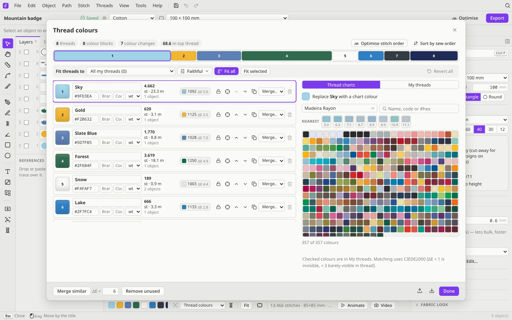

# Threads and colours

## The Thread colours dialog

Open it with **Threads → Thread colours…**, the spool button in the bottom bar, or by double-clicking a colour swatch.

On the left are the threads your design uses, in sew order, with each one's stitch count and length. On the right are two tabs:

- **Thread charts**: 75 charts from Ink/Stitch, covering Madeira, Isacord, Brother, Janome, Gunold, Robison-Anton and more, plus Madeira Cotona charts. Search by name or code, or pick a colour to replace the selected thread. **164 more charts** from the Embroidery Nerds thread database are an optional download. Their author hasn't published a licence, so Filum can't include them, but **Preferences → Downloads** fetches them from the author's repository in one click. Until then the chart menu shows a reminder.
- **My threads**: the spools you actually own. Add them from any chart, or add all of the design's threads in one click. You can export them as a `.gpl` palette.

**Fit threads to…** swaps every colour in the design for the closest thread you have, either from *My threads* or from a chart. Colours are compared the way your eye sees them (CIEDE2000), not by raw RGB values.

## The Threads menu

- **Fit design to My threads**, and **Revert fitted colours** if you change your mind
- **Match all to** the last chart you used
- **Merge similar colours**: join threads that are nearly the same, to save colour changes
- **Remove unused threads** and **Sort threads by sew order**
- **Palette → Import / Export** for `.gpl` palettes (Inkscape and GIMP use them too)
- **Thread list → Apply…** takes the colours from a TXT, COL, EDR or INF thread list, so you can match a file someone sent you. **Export (TXT)** writes your own list.

## The bottom bar

The swatches in the bottom bar are the colour changes in sew order. Click one to select its objects, or double-click it to open the Thread colours dialog. The **Colour the stitches by** menu can show *Thread colours*, the *Colour sequence* or *Monochrome*, which is handy for checking the sew order. **Only the active colour** dims everything else.

## Gradients

Filum has three kinds of gradient. All of them use the **Gradient tool** (<kbd>G</kbd>): drag across a fill to set the direction.

- **Colour gradients**: multi-colour fills of the *Linear*, *Reflect*, *Radial*, *Conic*, *Mesh* and *Points* kinds. Click the gradient line to add a colour stop, and <kbd>Alt</kbd>-click a stop to remove it. Every colour is its own layer on a shared stitch grid, so the density stays even. The colours mix with one of five dithers:
  - **Rows**: whole rows interleave, for smooth stripes and the fewest extra stitches
  - **Diffusion**: error diffusion, the most even and finest mix
  - **Woven**: an ordered pattern with a regular woven or pixel look
  - **Noise**: random, for an organic, painterly mix
  - **Bands**: no mixing, with hard colour edges

  Transition curves (*Linear*, *Smooth*, *Ease in*, *Ease out*, *Sharp*, *Steps*) and per-stop midpoints shape the blend.
- **Density gradients** (**Stitch → Gradient → Density gradient**): one colour that is dense where you start dragging and open where you stop. It's the classic shading effect.
- **Colour blending** (**Stitch → Gradient → Colour blending**): a second colour fades in over the first, using complementary densities. Both colours sew one shared set of rows, each row in one colour at a time, so the fill keeps an even density through the blend. Curved and flow fills do the same for colour gradients.
- **Rows across a gradient**: a straight-row gradient gets its rows across the gradient line, so each row is sewn in one colour. Redraw the line and the rows turn with it. Rows that run along a gradient split every row between the colours, and each colour's short pieces are joined by trims; the Issues list flags that, and **Turn rows across** fixes all the gradient's colours at once.

The density and blend profiles are *Linear*, *Ease in*, *Ease out*, *S-curve*, *Centre dense* and *Centre open*.
