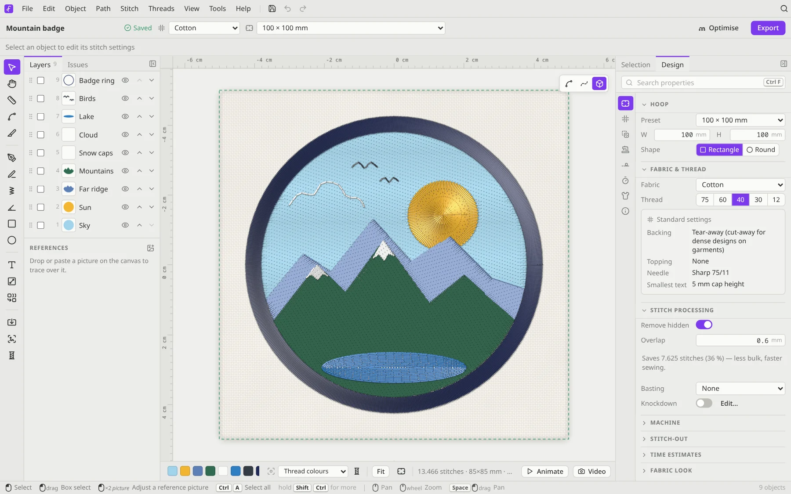
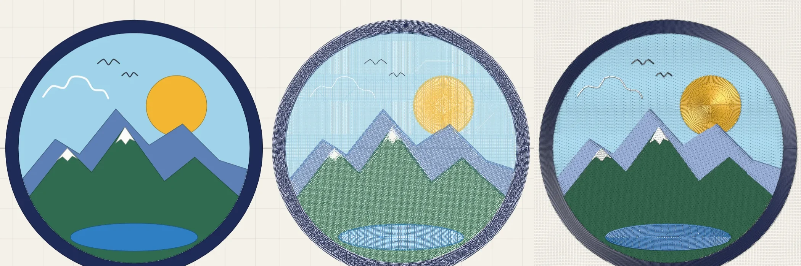
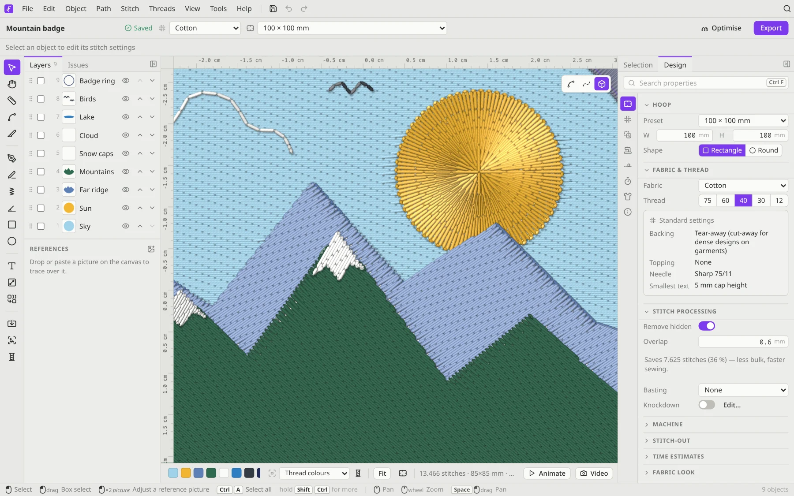
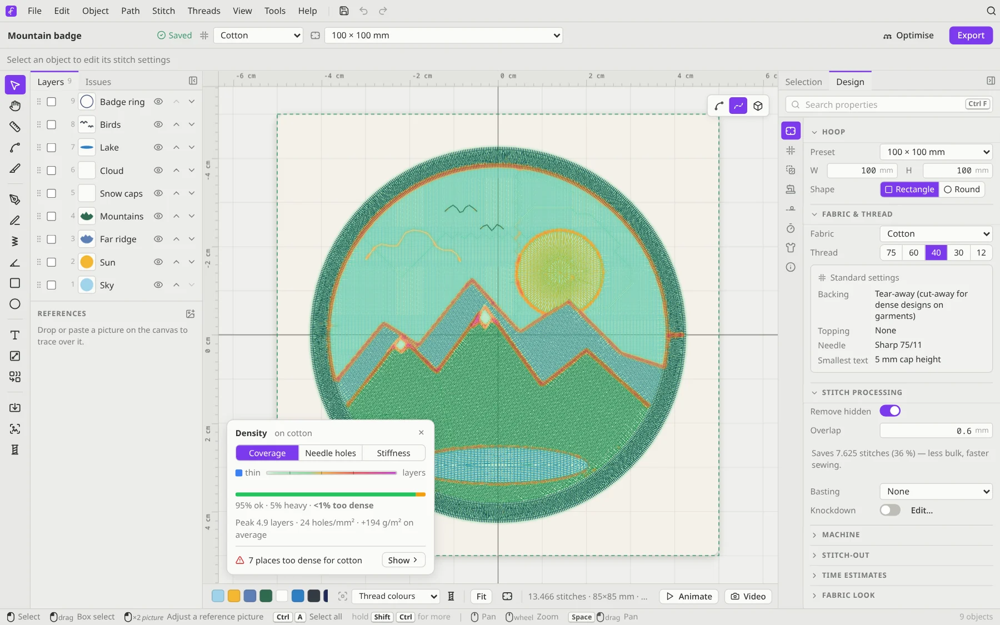
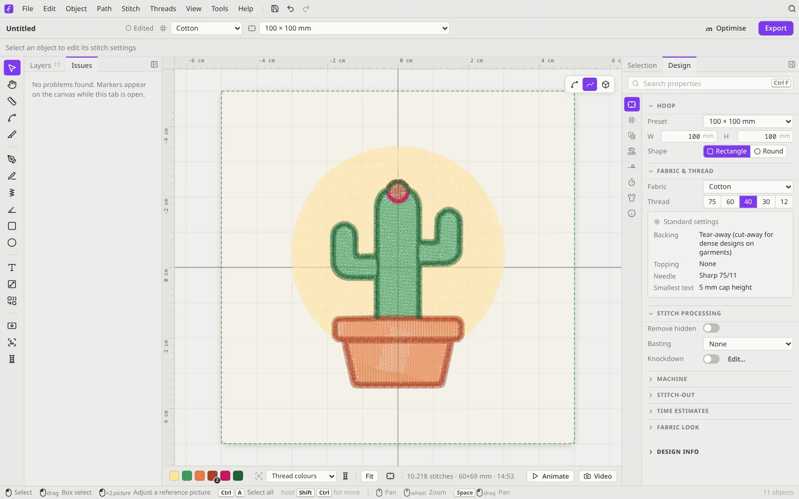
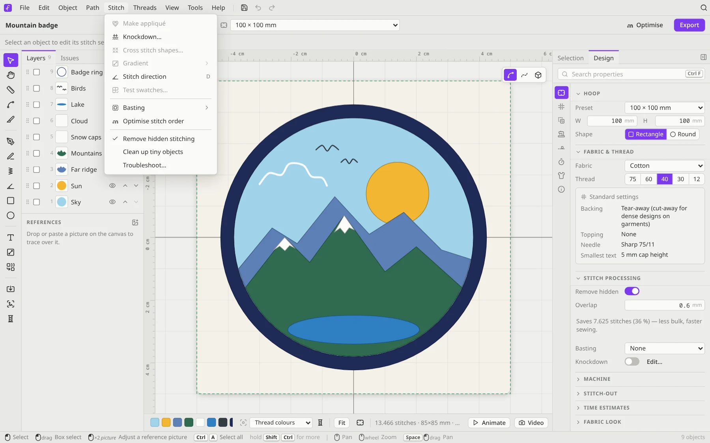
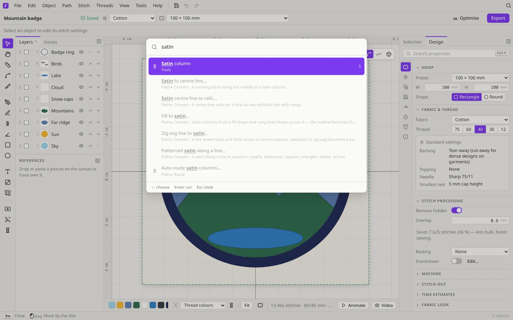
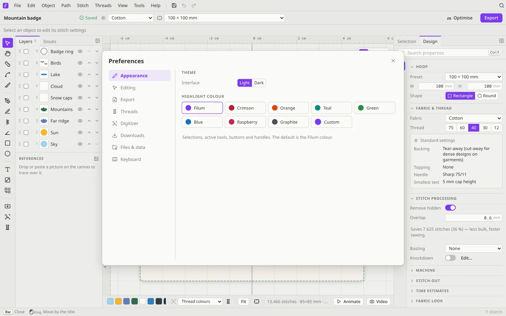
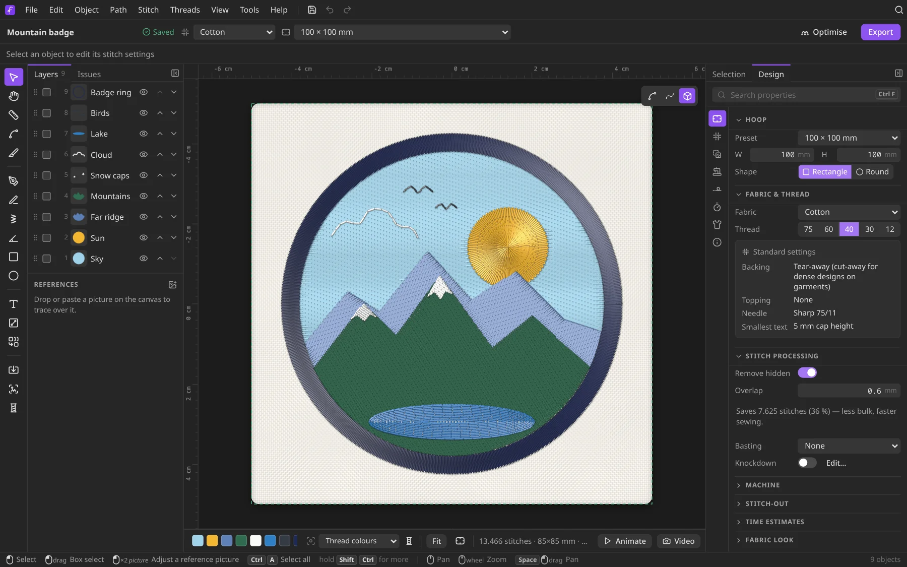

# A tour of the editor

From top to bottom, the window has:

1. **Menu bar**: File, Edit, Object, Path, Stitch, Threads, View, Tools and Help. On the right are save, undo and redo buttons and a magnifier that opens the command palette.
2. **Title bar**: the design's name and whether it's saved, the **Fabric** and **Hoop** pickers, **Optimise** and **Export**.
3. **Context bar**: options for the current tool or selection. Examples are the stitch type, the satin width or the font of a lettering object.
4. **Tool rail** (left edge): the drawing and editing tools. At the bottom are Import, Digitize a picture and Thread colours.
5. **Layers / Issues** (left panel): every object in the design, in sew order.
6. **Canvas**: the hoop and your design, with rulers. The buttons in its top-right corner switch the view.
7. **Selection / Design** (right panel): the settings for what you've selected, or for the whole design.
8. **Bottom bar**: the threads in sew order, the stitch count, size and sewing time, **Animate** and **Video**. **Animate** slides the stitch-out player up out of the bar: a timeline of the colour blocks with their trims and thread changes. The canvas makes room for it: when the hoop no longer fits, the view zooms out to keep all of it in sight, and zooms back when the player closes.
9. **Hints line**: what the mouse and keys do right now. Hold <kbd>Shift</kbd>, <kbd>Ctrl</kbd> or <kbd>Alt</kbd> and it shows only what that key changes.

## The three views

| Key | View | Good for |
|---|---|---|
| <kbd>1</kbd> | **Vector** | Drawing and editing shapes: clean, flat colours |
| <kbd>2</kbd> | **Stitch** | Checking stitch direction, density and underlay |
| <kbd>3</kbd> | **Realistic** | Seeing how it will look sewn, with thread sheen and fabric |

<kbd>4</kbd> (the scissors in the same switcher, or **View → Finished piece**) shows the stitch or realistic view as the finished piece: without the jump threads you snip by hand (the ones your machine doesn't cut, see [What your machine cuts](Production-Tools#what-your-machine-cuts)) and without the basting you pull out after sewing.

Zoom with the mouse wheel or <kbd>+</kbd> / <kbd>−</kbd> (it zooms at the cursor). Pan with <kbd>Space</kbd>+drag or the middle mouse button. <kbd>0</kbd> fits the hoop and <kbd>Shift</kbd>+<kbd>0</kbd> fits the design.

The **View** menu has more: jump stitches, underlay, a grid, smart guides, and a **Density map** (<kbd>Shift</kbd>+<kbd>D</kbd>) that shows where stitches pile up too thickly.

## Layers and Issues

**Layers** lists your objects. The top row is sewn **last**, so it sits on top. Drag rows to change the sew order, click the eye to hide an object, and tick boxes to select several. The **References** list underneath holds pictures you've placed to trace over. They're never stitched.

A **group** (<kbd>Ctrl</kbd>+<kbd>G</kbd>) shows as one header row with its name, how many objects it holds and their thread colours; its members are listed indented under it. Click the arrow (or press <kbd>←</kbd> / <kbd>→</kbd> on a focused header) to fold or unfold it, and the button at the top of the panel folds or unfolds every group at once. Clicking the header selects the whole group, its eye and lock buttons act on all members, and a double-click renames it. Grouping gathers the objects at the place of the topmost one in the sew order. Drag a header to move the whole group; drag an object onto a group's member to put it in the group, or out of the group's rows to take it out. The colour layers of a gradient or tartan show as a group too, and always stay together.

**Issues** checks the design while you work. It flags things like shapes outside the hoop, borders that cross themselves, satins that are too wide or too narrow, lettering too small for the thread, and long stitches that may snag. Click an issue to jump to it. Many issues have a fix button, and **Clean up** removes tiny leftover objects.

## Selection and Design

The right panel has two tabs, and Filum switches between them for you:

- **Selection** shows what's selected: *Transform*, *Thread*, *Stitch patterns*, *Stitch options*, *Commands* and *Element info*. Lettering has its own sections: *Text*, *On a path*, *Shape*, *Stitches*, *Batch lettering* and *Font*.
- **Design** covers the whole design: *Hoop*, *Fabric & thread*, *Stitch processing*, *Machine*, *Stitch-out*, *Time estimates*, *Fabric look* and *Design info*.

Lost a setting? Type into **Search properties** (<kbd>Ctrl</kbd>+<kbd>F</kbd>) at the top of the panel.

## Menus and the command palette

Every command lives in a menu, and most also appear in the right-click menu for whatever is under the pointer.

If you don't know where something is, press <kbd>Ctrl</kbd>+<kbd>K</kbd> and type what you want, like "satin", "mirror" or "trim". The **command palette** searches every menu command, and the ones you've used recently come first.

## Making it yours

**Edit → Preferences** (<kbd>Ctrl</kbd>+<kbd>,</kbd>) has these sections:
- **Appearance**: light or dark theme, plus a highlight colour (Filum violet, Crimson, Orange, Teal, Green, Blue, Raspberry, Graphite or your own).
- **Editing**: snapping, and how far the arrow keys nudge.
- **Export**: the default format, PES version, machine and hoop for new designs.
- **Threads**: colour matching and your own threads.
- **Digitizer**: its settings and the on-device AI.
- **Downloads**: optional fonts and thread charts Filum can't include, each with its licence and a one-click **Accept & download**, plus a list of what's included and under which licences.
- **Files & data**: autosave.
- **Keyboard**: shortcut hints.

You can rearrange the panels too: **View → Panels** puts the layers on the left or above the properties, hides the panels (<kbd>Ctrl</kbd>+<kbd>\\</kbd>), or resets the layout.

